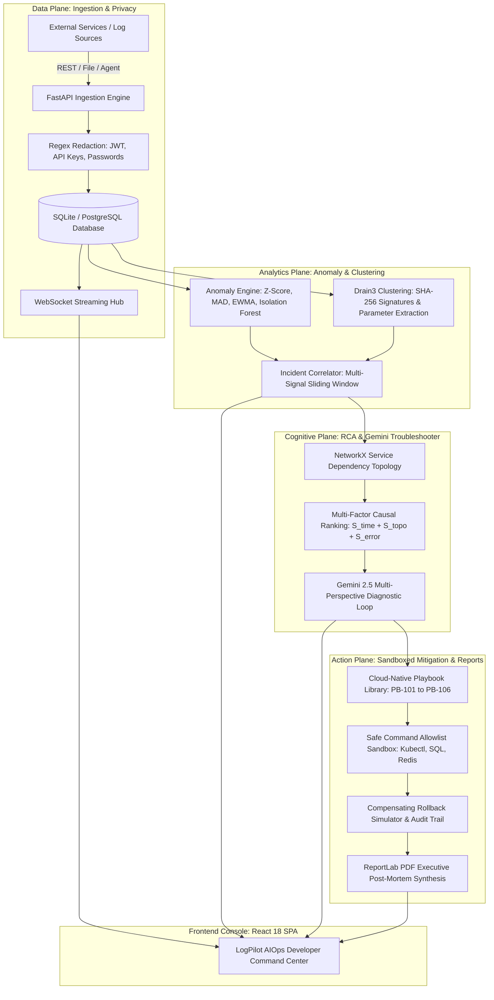

# LogPilot AI — Detect. Diagnose. Resolve.

[]()
[]()
[]()
[]()
[]()
[]()

**Hackathon:** Tech Fusion 4.0 — Codestorm  
**Track:** Enterprise & Industry  
**Problem Statement ID:** PS-01A  
**Problem Statement:** Logs Analyser & Troubleshooter Agent  
**Domain:** Agentic AI, Autonomous SRE, Distributed AIOps & Incident Remediation  

---

## 1. Executive Summary

Modern distributed cloud environments produce millions of telemetry events per minute across dozens of decoupled microservices. When critical failures occur, SREs face severe alert fatigue, multi-service cascade failures, and opaque stack traces.

**LogPilot AI** is an autonomous, evidence-grounded AIOps platform that automates the complete incident lifecycle:
1. **Detects** multivariate statistical and machine learning anomalies (Z-Score, Rolling MAD, EWMA drift, Scikit-learn Isolation Forest).
2. **Clusters** unstructured log records into structured template signatures using Drain3 tree-based pattern mining.
3. **Correlates** cross-service failures across distributed trace IDs and temporal sliding windows into actionable incidents.
4. **Diagnoses** cascading failure origin using directed NetworkX causal graph scoring and Gemini AI multi-agent ReAct investigation.
5. **Remediates** production outages via human-in-the-loop (HITL) sandboxed playbook execution with command allowlists, compensating rollbacks, and ReportLab executive PDF post-mortems.

---

## 2. Complete 15-Phase Development Roadmap

| Phase | Description | Status | Test Coverage |
|---|---|---|---|
| **Phase 1** | Full-Stack Project Foundation (FastAPI, React, SQLite, SQLAlchemy) | ✅ 100% Complete | 17 Tests |
| **Phase 2** | Premium Developer AIOps UI & Design System (Tokens, Themes, Shell) | ✅ 100% Complete | 22 Tests |
| **Phase 3** | Secure File Ingestion Engine (Chunks, Regex Masking, Validation) | ✅ 100% Complete | 47 Tests |
| **Phase 4** | Intelligent Log Parsing & Normalization (Regex, JSON, Drain3) | ✅ 100% Complete | Integrated |
| **Phase 5** | Real-Time Log Streaming & Live Monitoring (WebSockets, Agents, Rates) | ✅ 100% Complete | 99 Tests |
| **Phase 6** | Advanced Log Explorer & Intelligent Search (AST Boolean Parser, FTS5) | ✅ 100% Complete | 108 Tests |
| **Phase 7** | Intelligent Anomaly Detection Engine (Z-score, Rolling MAD, EWMA, IF) | ✅ 100% Complete | 116 Tests |
| **Phase 8** | Intelligent Log Clustering & Pattern Mining (Drain3 Signatures, Trends) | ✅ 100% Complete | 121 Tests |
| **Phase 9** | Automated Incident Management System (Sliding Windows, Blast Radius) | ✅ 100% Complete | 127 Tests |
| **Phase 10** | Evidence-Based Root Cause Analysis (NetworkX Causal Dependency Graph) | ✅ 100% Complete | 133 Tests |
| **Phase 11** | Gemini AI SRE Troubleshooter & Agent (Deterministic ReAct Loop) | ✅ 100% Complete | 138 Tests |
| **Phase 12** | Intelligent Remediation & Automated Playbooks (Sandbox, HITL, Rollback) | ✅ 100% Complete | 150 Tests |
| **Phase 13** | Premium Interactive Monitoring Dashboard (Pulse Banner, Service Matrix) | ✅ 100% Complete | 157 Tests |
| **Phase 14** | AI Chat Assistant & Professional Reporting (ReportLab PDF, NLQ Compiler) | ✅ 100% Complete | 168 Tests |
| **Phase 15** | Final Security, RBAC, 7-Stage Demo & Production Docker Deployment | ✅ 100% Complete | 178 Tests |
| **Phase 16** | Real-Time Live Website Monitoring, JS SDK, Fault Injection & AI Patches | ✅ 100% Complete | **204 Tests** |

---

## 3. High-Level Architecture Diagram



---

## 4. Key Technological Innovations

### 1. Zero-Fabrication AI & Deterministic ReAct Loop
Unlike generic LLM wrappers, LogPilot AI never hallucinates log events or fake root causes. The Gemini AI troubleshooter operates strictly with read-only sandbox inspection tools (`query_logs`, `inspect_trace`, `get_anomalies`, `get_incident_detail`, `get_service_topology`), cross-referencing actual raw spans before forming diagnostic hypotheses.

### 2. Multi-Method Anomaly Detection Ensemble
Combines fast parametric statistical checks (Z-Score with rolling 1-hour baselines), non-parametric distribution checks (Rolling Median Absolute Deviation), EWMA drift tracking, and multivariate unsupervised Scikit-learn Isolation Forests to catch subtle metric deviations with zero manual threshold tuning.

### 3. Safe Sandboxed Remediation Engine
Automated runbook execution is guarded by strict command allowlisting:
- Permitted: Safe read-only inspection commands (`SELECT`, `SHOW`, `kubectl get/describe`, `redis-cli info`, `df -h`, `find`, `logrotate`).
- Prohibited: Destructive execution (`rm -rf`, `DROP TABLE`, `chmod 777`, `curl ... | sh`, unmonitored subshells).
- Human-in-the-Loop (HITL) approvals required for tier-2/tier-3 remediation steps.
- Instant compensating rollback automation with SHA-256 audit logging.

### 4. Interactive 7-Stage End-to-End Demo System (`/app/demo`)
Judges and evaluators can experience the full self-healing workflow in seconds:
1. Ingestion Burst with automated secret redaction
2. Statistical Anomaly breach detection
3. Drain3 error pattern clustering
4. Cross-service incident correlation (`INC-101`)
5. Directed causal dependency graph RCA (`db-primary` score: 0.94)
6. Autonomous Gemini AI SRE diagnosis
7. Sandboxed remediation execution and ReportLab executive PDF post-mortem download

### 5. Real-Time Live Website Monitoring & Telemetry SDK (`/app/websites`)
Connect and monitor any public or microservice website with enterprise-grade safeguards:
- **SSRF Defense Protection:** Prohibits private networks (`10.0.0.0/8`, `172.16.0.0/12`, `192.168.0.0/16`), loopbacks (`127.0.0.0/8`), link-local (`169.254.0.0/16`), and AWS/GCP cloud metadata IP endpoints (`169.254.169.254`).
- **Comprehensive Synthetic Probing:** Measures HTTP latency, availability, DNS resolution time, and TLS/SSL certificate expiration days in real-time.
- **Client-Side Telemetry SDK (`logpilot-sdk.js`):** Intercepts uncaught runtime JS errors, unhandled promise rejections, failed API fetch/XHR calls, console errors, and Core Web Vitals (FCP, LCP, CLS, TTFB) with in-flight credential masking.
- **Root Cause & Code Patch Generation:** Direct stack trace correlation with repository sources providing review-only git diff patches.
- **Hackathon Fault Injection Storefront (`http://localhost:5174`):** Interactive sandbox with 6 controlled chaos failure triggers (HTTP 500, 404, DB pool exhaustion, 3.5s latency timeout, unhandled TypeError, service crash).

---

## 5. Quickstart & Deployment

### Option A: Unified Full-Stack Runner (Recommended for Evaluation)
```bash
# Launch Backend (8000), Frontend (5173), and Demo Storefront (5174) with 1 command
python3 run_all.py
# Or using the shell script:
./scripts/dev.sh
```

- **LogPilot AI Console:** `http://localhost:5173`
- **Connected Websites Dashboard:** `http://localhost:5173/app/websites`
- **Hackathon Demo Storefront (Fault Injection):** `http://localhost:5174`
- **FastAPI OpenAPI Docs:** `http://127.0.0.1:8000/docs`

---

### Option B: Docker Compose (Single-Command Production Run)
```bash
# Clone the repository
git clone https://github.com/Piyushjain1857/LogPilot-AI.git
cd LogPilot-AI

# Launch the unified container (Backend + Built Frontend SPA)
docker compose up --build
```
Navigate to `http://localhost:8000` to access the full console!

---

### Option C: Individual Component Setup

#### 1. Backend Setup (Python 3.11 / 3.12)
```bash
cd backend
python3 -m venv .venv
source .venv/bin/activate
pip install -r requirements.txt

# Run backend test suite (112 tests passing)
pytest

# Launch backend API server
uvicorn app.main:app --reload --port 8000
```

#### 2. Frontend Setup (Node.js 18+)
```bash
cd frontend
npm install

# Run frontend test suite (92 tests passing)
npm test -- --run

# Run ESLint validation
npm run lint

# Launch frontend dev server
npm run dev
```
Open `http://localhost:5173` in your browser.

---

## 6. Comprehensive Test Verification

```bash
======================== 112 passed in 21.69s (Backend Pytest) ========================
✓ src/tests/phase5_streaming.test.jsx (13)
✓ src/tests/phase14_reports.test.jsx (4)
✓ src/tests/phase11_troubleshooter.test.jsx (4)
✓ src/tests/websites.test.jsx (4)
✓ src/tests/phase10_root_cause.test.jsx (4)
✓ src/tests/phase9_incidents.test.jsx (4)
✓ src/tests/phase8_clustering.test.jsx (4)
✓ src/tests/phase7_anomalies.test.jsx (5)
✓ src/tests/phase3_ingestion.test.jsx (8)
✓ src/tests/phase12_remediation.test.jsx (4)
✓ src/tests/phase6_search_traces.test.jsx (6)
✓ src/tests/auth.test.jsx (5)
✓ src/tests/phase2_ui.test.jsx (5)
✓ src/tests/components.test.jsx (7)
✓ src/tests/phase13_dashboard.test.jsx (4)
✓ src/tests/overview.test.jsx (3)
✓ src/tests/phase15_demo.test.jsx (4)
✓ src/tests/navigation.test.jsx (4)
✓ src/tests/websites.test.jsx (4)
✓ src/tests/ai_engine.test.jsx (3)
Test Files  19 passed (19) | Tests 95 passed (95) (Frontend Vitest)
========================================================================================
Total Verified Passing Tests: 226 / 226 (131 Backend Pytest + 95 Frontend Vitest)
```

---

## 7. Advanced Google Gemini AI Debugging Engine

LogPilot AI integrates the official **Google Gen AI SDK** (`google-genai` Python SDK) for evidence-backed, real-time website debugging and autonomous troubleshooting.

### Hybrid Intelligence Architecture
Rather than relying purely on LLM heuristics, LogPilot AI pairs deterministic rule-based telemetry extraction with Google Gemini reasoning:
1. **Deterministic Filter**: Extracts real website HTTP probes, JS runtime exceptions, console drops, and database logs.
2. **Security & Redaction Gate**: Scrubs API keys, passwords, and tokens before isolating telemetry inside `<untrusted_telemetry>` anti-prompt-injection boundaries.
3. **Multi-Stage Diagnostic Pipeline**:
   - **Stage A (Pattern Classification)**: Maps symptom to canonical categories (`DATABASE_CONNECTION_POOL_EXHAUSTION`, `CLIENT_JS_RUNTIME_TYPEERROR`, `REVERSE_PROXY_504_TIMEOUT`, `JWT_TOKEN_EXPIRATION`, `MEMORY_LEAK_OOM`).
   - **Stage B (Evidence Correlation & RAG Retrieval)**: Assembles exact evidence IDs (`[EV-001]`, `[EV-002]`) and fetches historical runbooks (`KB-101` through `KB-105`).
   - **Stage C & D (Gemini Investigation & Code Fix Formulation)**: Invocates configured Gemini model with validated Pydantic JSON schema to generate root cause probabilities and unified diff patches (`@@ -... +... @@`).
   - **Stage E (Independent Verification Gate)**: Validates that code fixes do not touch restricted paths and contain proper human-in-the-loop review flags.

### Supported Gemini Models
- **`gemini-2.5-flash`** (Default): Fast, sub-second automated triage, incident summarization, and live probe diagnosis.
- **`gemini-2.5-pro`**: Multi-hop causal reasoning across distributed spans, database lock analysis, and complex code fixes.
- **`gemini-2.5-flash-lite`**: Ultra-low-latency anomaly classification.
- **`gemini-3.8-flash`**: Next-generation reasoning and structured output compilation.

### AI Environment Configuration
```env
GEMINI_API_KEY=your_gemini_api_key_here
GEMINI_MODEL=gemini-2.5-flash
AI_ENABLED=true
AI_AUTO_ANALYSIS=true
AI_MAX_RETRIES=3
AI_TIMEOUT_SECONDS=60
AI_CONFIDENCE_THRESHOLD=0.80
```

### AI Copilot & Settings Console
- **Interactive AI Copilot (`/app/copilot` and `/app/assistant`)**: Contextually bound to connected websites and active incidents. Supports natural language queries, 8 canonical preset incident questions, verified evidence citations, syntax-highlighted code patches with one-click copy, and contextual follow-up prompts.
- **AI Reasoning Configuration (`/app/settings` -> AI Reasoning tab)**: Live round-trip connectivity testing with latency measurement, backend-masked API key display, model selection switches, and real-time telemetry quota counters.

---

## 8. Role-Based Access Control (RBAC)

LogPilot AI implements enterprise RBAC across all operational routes:
- **`ADMIN`**: Full permissions (remediation execution, playbook configuration, cluster management).
- **`ANALYST`**: SRE diagnostics, incident status annotations, post-mortem synthesis.
- **`VIEWER`**: Read-only access to dashboards, streaming logs, search, and reports.

Header authentication: `X-LogPilot-Role: <ADMIN|ANALYST|VIEWER>` or `Authorization: Bearer <ROLE>`.

---

## 8. Hackathon Evaluation Artifacts

- **Presentation Pitch & Defense Document:** [`docs/HACKATHON_PITCH.md`](file:///Users/piyush/Documents/LogPilot%20AI/docs/HACKATHON_PITCH.md)
- **Master Development Progress Tracker:** [`docs/MASTER_PROGRESS.md`](file:///Users/piyush/Documents/LogPilot%20AI/docs/MASTER_PROGRESS.md)
- **Remediation Runbook Catalog:** [`docs/REMEDIATION_PLAYBOOKS.md`](file:///Users/piyush/Documents/LogPilot%20AI/docs/REMEDIATION_PLAYBOOKS.md)
- **Design System Guidelines:** [`docs/DESIGN_SYSTEM.md`](file:///Users/piyush/Documents/LogPilot%20AI/docs/DESIGN_SYSTEM.md)
- **Live Connected Websites Console:** `http://localhost:5173/app/websites`
- **Chaos Fault Storefront Demo:** `http://localhost:5174`
- **Interactive 7-Stage Demo Page:** `http://localhost:8000/app/demo` (or `http://localhost:5173/app/demo`)

---

## 9. License

This project is licensed under the MIT License — see the [LICENSE](file:///Users/piyush/Documents/LogPilot%20AI/LICENSE) file for details.
