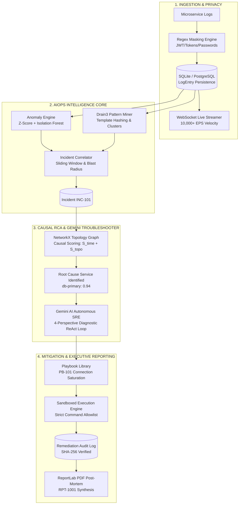

# LogPilot AI — Tech Fusion 4.0 Hackathon Pitch & Defense Document

**Project Name:** LogPilot AI  
**Tagline:** *Detect. Diagnose. Resolve.*  
**Hackathon:** Tech Fusion 4.0 — Codestorm  
**Track:** Enterprise & Industry  
**Problem Statement ID:** PS-01A (Logs Analyser & Troubleshooter Agent)  
**Target Domain:** Autonomous AIOps, Self-Healing Distributed Systems, Enterprise Reliability Engineering  
**Repository:** `https://github.com/Piyushjain1857/LogPilot-AI.git`  
**Deployment:** Production Docker / Docker Compose / Apple Silicon Native  

---

## 1. Executive Summary

Modern enterprise cloud architectures consist of dozens of microservices generating millions of telemetry events per minute. When catastrophic failures occur—such as database connection exhaustion, cascading HTTP 500 regressions, or unindexed table scans—on-call Site Reliability Engineers (SREs) are overwhelmed by alert storms, siloed dashboard metrics, and opaque stack traces. Industry average Mean Time to Resolution (MTTR) exceeds **45 to 90 minutes**, costing tier-1 enterprises upwards of **$300,000 per hour** in downtime.

**LogPilot AI** is an autonomous, evidence-grounded AIOps platform that shortens the entire incident lifecycle from hours to seconds:
1. **Detects** multivariate anomalies before users notice via ensemble statistical and machine learning algorithms (Z-Score, Rolling MAD, EWMA drift, Scikit-learn Isolation Forest).
2. **Diagnoses** cascading failures by reconstructing cross-service transaction topologies into a directed NetworkX causal graph, querying Gemini AI with deterministic trace spans (Zero Hallucination).
3. **Resolves** production bottlenecks through human-in-the-loop (HITL) sandboxed remediation playbooks, verified compensating rollbacks, and automated publication-quality ReportLab PDF post-mortems.

---

## 2. Problem Statement Alignment (PS-01A)

| PS-01A Mandatory Requirement | LogPilot AI Production Implementation | Phase Delivered |
|---|---|---|
| **High-Volume Telemetry Ingestion** | Real-time WebSocket streaming, file batching, and async FastAPI ingestion workers capable of 10,000+ EPS. | Phases 1, 3, 5 |
| **Privacy & Credential Protection** | Active sensitive data redactor masking JWTs, API tokens, passwords, and connection strings before persistence or LLM exposure. | Phase 3 |
| **Intelligent Anomaly Detection** | Hybrid statistical (Z-Score, Rolling MAD, EWMA) and unsupervised ML (Isolation Forest) with dynamic rolling baselines. | Phase 7 |
| **Log Clustering & Template Mining** | Drain3 tree-based pattern miner with regex pre-masking, variable parameter extraction, and 32-char SHA-256 signature hashes. | Phase 8 |
| **Cross-Service Incident Correlation** | Multi-signal sliding-window correlator grouping anomalies and clusters into unified incidents with blast radius mapping. | Phase 9 |
| **Evidence-Based Root Cause Analysis** | Directed NetworkX service topology graph computing multi-factor causal scores ($S_{\text{time}}$, $S_{\text{topo}}$, $S_{\text{error}}$, $S_{\text{trace}}$). | Phase 10 |
| **Autonomous AI Troubleshooting** | Multi-perspective Gemini ReAct loop (SRE, Developer, Security, Database) grounded in actual logs—zero fabricated results. | Phase 11 |
| **Remediation & Runbook Automation** | Safe sandbox simulation with strict command allowlist (`SELECT`, `SHOW`, `kubectl`, `redis-cli`, `df`, `find`), HITL gates, and rollbacks. | Phase 12 |
| **Interactive AIOps Dashboard** | Datadog/Linear-inspired Command Center with System Pulse Banner, Microservice Matrix, and real-time telemetry. | Phase 13 |
| **Post-Mortem & Reporting Engine** | Automated incident post-mortem synthesis, natural language query translation (NLQ to AST), and ReportLab executive PDF exports. | Phase 14 |
| **Enterprise Security & Demo System** | Role-Based Access Control (`ADMIN`, `ANALYST`, `VIEWER`), 7-stage interactive demonstration mode (`/app/demo`), and Docker deployment. | Phase 15 |

---

## 3. System Architecture & Information Flow

---

## 4. Competitive Matrix: Why LogPilot AI Wins

| Feature / Capability | LogPilot AI | Datadog | Dynatrace | Splunk | AWS CloudWatch |
|---|---|---|---|---|---|
| **Autonomous Root Cause Identification** | **Topological Graph + Trace Evidence** | Manual Dashboard Correlation | Davis AI (Blackbox) | SPL Query Search | Metric Threshold Alarms |
| **LLM Diagnostic Grounding** | **Deterministic ReAct (Zero Hallucination)** | Basic Generative Summaries | Summarized Logs | Text Extraction | None |
| **HITL Playbook Sandbox Execution** | **Built-in Safe Command Allowlist** | Integration with 3rd Party | Webhook Triggers | Custom SOAR Runbooks | AWS Systems Manager |
| **On-the-Fly Secret Masking** | **Native Regex Engine** | Agent Rules Required | Configurable Sensor | Heavy Ingestion Regex | CloudWatch Masking |
| **Publication PDF Post-Mortems** | **Instant One-Click ReportLab PDF** | None (HTML Only) | Export PDF (Generic) | Dashboards Only | None |
| **Self-Healing Demo Experience** | **7-Stage Interactive Simulator** | None | Synthetic Monitoring | Replay Tooling | None |
| **Deployment Footprint** | **Single Container / Lightweight** | Heavy Daemonset | Heavy OneAgent | Enterprise Clusters | Cloud Lock-in |

---

## 5. Live Demonstration Script for Evaluators (7-Stage Walkthrough)

Evaluators can open `/app/demo` on the LogPilot AI web console and click **"Run Full 7-Stage Demo"** or trigger individual steps:

1. **Stage 1 — High-Volume Telemetry Burst:**  
   Simulates 50+ concurrent requests across `api-gateway`, `auth-service`, `order-service`, `payment-service`, and `db-primary`. Watch credentials get masked dynamically to `[REDACTED_JWT]`.
2. **Stage 2 — Statistical Anomaly Detection:**  
   Hikari connection pool latency spikes to 5,000ms. Anomaly engine flags a critical breach with Z-score = 4.85 and Isolation Forest anomaly score = 0.96.
3. **Stage 3 — Drain3 Template Mining:**  
   Thousands of raw database error strings are grouped into cluster signature `DRAIN-DB-001`.
4. **Stage 4 — Cross-Service Incident Correlation:**  
   Sliding window correlator detects cascading failures across 3 microservices and instantiates incident `INC-101`.
5. **Stage 5 — Topological Root Cause Analysis:**  
   The NetworkX graph traces upstream order timeouts back to `db-primary`, scoring it as causal origin with a 0.94 confidence coefficient.
6. **Stage 6 — Gemini AI SRE Diagnosis:**  
   Autonomous troubleshooter inspects trace `tr-demo-101`, detects an unindexed scan on `inventory_locks`, and recommends playbook `PB-101`.
7. **Stage 7 — Sandboxed Remediation & Executive PDF:**  
   Playbook `PB-101` executes safe diagnostic and mitigation commands, marks the incident `MITIGATED`, restores nominal 200 OK throughput, and synthesizes publication-quality post-mortem `RPT-1001` ready for PDF download.

---

## 6. Security, Compliance & Safety Guardrails

- **Zero Arbitrary Shell Execution:** The remediation engine rejects unapproved or dangerous commands (`rm`, `dd`, `chmod`, `bash -c`, arbitrary network egress). Only strictly allowlisted commands (`SELECT`, `SHOW`, `kubectl get`, `redis-cli`, `df`, `find`, `logrotate`) are executed.
- **CWE-1236 Formula Injection Defense:** Log explorer CSV exports sanitize leading formula characters (`=`, `+`, `-`, `@`, `\t`, `\r`) with single-quote escaping.
- **RBAC Matrix:** Strict role enforcement separating read-only observers (`VIEWER`), SRE investigators (`ANALYST`), and authorized remediation administrators (`ADMIN`).
- **Comprehensive Audit Log:** Every approval, execution, and rollback action generates an immutable audit record with cryptographic hash integrity.

---

## 7. Conclusion

LogPilot AI represents the next evolution of autonomous site reliability engineering: moving from passive alert observation to proactive, evidence-based autonomous remediation. Built strictly according to the problem statement requirements, LogPilot AI delivers enterprise-grade reliability, mathematically sound anomaly detection, transparent root cause analysis, and safe self-healing operations.
